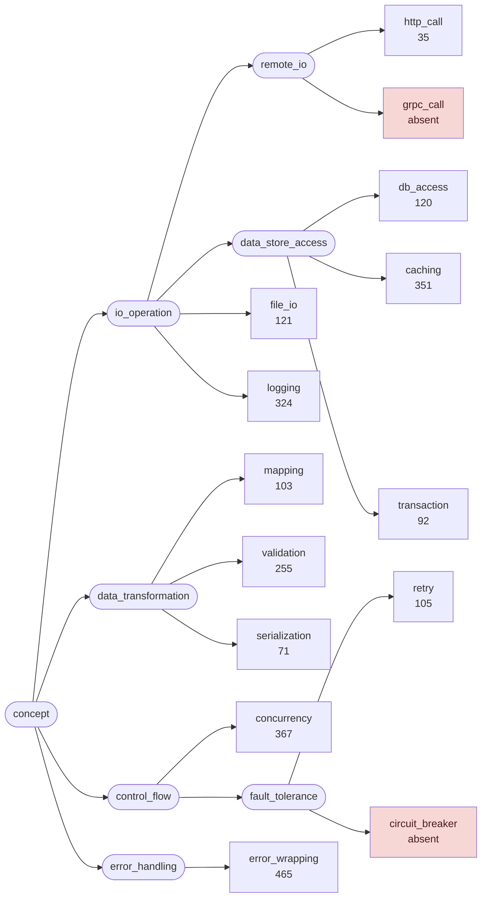
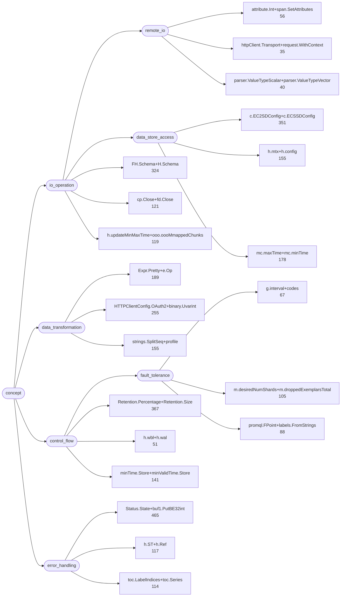
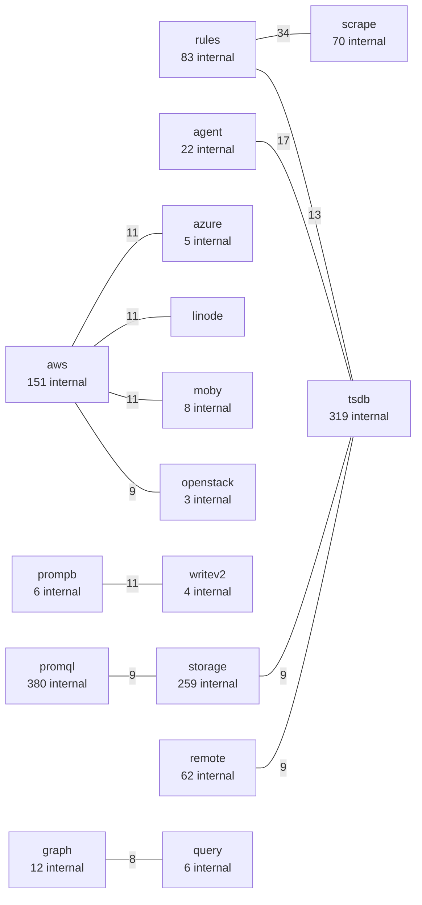

# prometheus

monitoring system; storage engine, query language, and scrape pipeline in one tree

**What this rung shows:** deep call graphs and role classification on a genuinely layered corpus

| | |
|---|---|
| Corpus | [prometheus](https://github.com/prometheus/prometheus) |
| Pinned at | `v3.14.0` (`d7598b7141418fa35be2b5ec5d0fefb634199610`) |
| Project since | 2012 |
| doppel | `103ec8f` |
| Command | `doppel analyze . --tests exclude --moves=false --top 10` |

Run from the corpus root, so every path below is corpus-relative.
Regenerate with `task examples`; CI regenerates on every push to master.

## Run diagnostics

The corpus-level models doppel builds before ranking anything, as printed to stderr:

```
Scanning . ...
Learning concept vocabulary...
Lexicon: 390 concepts (12 seeded, 378 emergent), 17324/43509 features above 2068 df, 660 functions unlabeled
Generating concept documents...
Calibration: rate 0.01 over 20000 null pairs -> threshold 0.33, struct-min 0.34, family-min 0.33
Found 5623 functions. Retrieving candidates...
Retrieval: shape 8050, concept 17022, call 8171 -> 29068 unique pairs
  concept-only 50.7%  call-only 18.8%  suppressed-shape functions: 12  large identity buckets: 0  surviving labels: 30362
  125 cross test/prod pairs dropped
  66 cross build-target pairs dropped (no build compiles both files)
Running structural comparison on 28877 pairs...
  Concept views: 1729 of 28877 compared pairs disagree with the taxonomy (184 vocabulary the tree misses, 1545 kinship the vocabularies lack)
  13018 pairs remain after struct-min=0.34 filter
Culture: 360 concepts modeled, 2597 associations, 739 unusual realizations
Habitats: 97 modeled, 116 misfits (58 excused by subsystem), 22 subsystems; most uniform graphite (norm 1.00), most diverse src (norm 0.65)
Conventions: strongest b.Bytes+b.Len (0.98), loosest n.StartOrEnd+n.Func (0.13)
Ecosystems: 5268 profiled (2720 dominance, 2510 coalition, 0 conflict, 38 weak)
Families: 916 over 626 components, 2039 functions in a family, 8414 edges completed
  2 component(s) skipped as too large or too dense: sizes [233 661]
```

# Code Similarity Report

**Functions analyzed:** 5623 | **Threshold:** 0.33 | **Pairs found:** 10

---

## What doppel sees

**5623 functions** across **124 packages** — test functions excluded. Structural roles: 3435 leaf, 1140 orchestrator, 302 passthrough, 746 utility.

### Concepts

Two pictures of the same vocabulary. The first is what doppel **searched with**: an authored tree of fourteen seed practices, each leaf showing how many functions here ended up in a concept that seed grew. It is the same shape on every corpus, which is what makes it the one concept picture two runs can be compared on. The second is what this corpus **turned out to have**: concepts learned from the code itself, named after the evidence that identified them, hung from that same interior — so two functions under one *branch* score partial credit rather than nothing. Counts are members; membership is graded, and a function can carry several.

**What doppel looked for, and how much of it grew here.**



**What it learned instead.**



The diagram draws the 3 largest concepts on each branch; **369 further concepts** are left out of the picture and listed in the table below.

**No practice here for** `circuit_breaker`, `grpc_call`. Concepts are learned from this corpus, so one can never be absent — it exists because functions carry it. These are the *seeds* the search started from that grew nothing: a direct answer to "does this codebase already do X".

| Concept | Functions | Convention |
|---|---:|---|
| `Status.State+buf1.PutBE32int` | 465 | `0.56` (settled) |
| `Retention.Percentage+Retention.Size` | 367 | `0.44` (loose) |
| `c.EC2SDConfig+c.ECSSDConfig` | 351 | `0.53` (settled) |
| `FH.Schema+H.Schema` | 324 | `0.50` (loose) |
| `HTTPClientConfig.OAuth2+binary.Uvarint` | 255 | `0.53` (settled) |
| `Expr.Pretty+e.Op` | 189 | `0.55` (settled) |
| `mc.maxTime+mc.minTime` | 178 | `0.58` (settled) |
| `h.mtx+h.config` | 155 | `0.60` (settled) |
| `strings.SplitSeq+profile` | 155 | `0.60` (settled) |
| `appErrs.numDuplicates+appErrs.numExemplarOutOfOrd…` | 142 | `0.51` (settled) |
| `minTime.Store+minValidTime.Store` | 141 | `0.51` (settled) |
| `cp.Close+fd.Close` | 121 | `0.48` (loose) |
| `api.enableAdmin+autoCompactMtx.Lock` | 120 | `0.45` (loose) |
| `h.updateMinMaxTime+ooo.oooMmappedChunks` | 119 | `0.50` (loose) |
| `h.ST+h.Ref` | 117 | `0.51` (settled) |
| `toc.LabelIndices+toc.Series` | 114 | `0.54` (settled) |
| `http.HandlerFunc+http.ResponseWriter` | 106 | `0.61` (settled) |
| `m.desiredNumShards+m.droppedExemplarsTotal` | 105 | `0.41` (loose) |
| `c.ConvertClassicHistogramsT…+convertnhcb.GetHistogramMet…` | 103 | `0.55` (settled) |
| `result.TotalSamples+ss.Floats` | 101 | `0.48` (loose) |
| `ev.matrixIterSlice+storage.NewBuffer` | 98 | `0.52` (settled) |
| `fmt.Errorf+encoding.*Encbuf.PutBE32` | 94 | `0.51` (settled) |
| `appender.Commit+appender.Rollback` | 92 | `0.53` (settled) |
| `api.parseMatchersParam+r.ParseForm` | 90 | `0.44` (loose) |
| `OutOfOrderTimeWindow.Load+h.appendableMinValidTime` | 89 | `0.49` (loose) |
| `promql.FPoint+labels.FromStrings` | 88 | `0.53` (settled) |
| `e.Op+ev.endTimestamp` | 84 | `0.55` (settled) |
| `kingpin.New+HelpFlag.Short` | 83 | `0.57` (settled) |
| `it.Seek+it.AtFloatHistogram` | 79 | `0.55` (settled) |
| `r.labels+ts.Sub` | 78 | `0.44` (loose) |
| `api.parseMatchersParam+Queryable.Querier` | 74 | `0.42` (loose) |
| `engine.NewInstantQuery+promql.Scalar` | 74 | `0.49` (loose) |
| `json.MarshalIndent+json.NewDecoder` | 71 | `0.44` (loose) |
| `set.At+set.Warnings` | 71 | `0.47` (loose) |
| `result.TotalSamples+it.Reset+ss.Floats` | 70 | `0.51` (settled) |
| `g.interval+codes` | 67 | `0.49` (loose) |
| `querier.Close+errors.Join` | 67 | `0.58` (settled) |
| `engine.NewInstantQuery+promql.Scalar+q.Exec` | 64 | `0.52` (settled) |
| `b.commonSearchPostProps+yaml.ScalarNode` | 63 | `0.57` (settled) |
| `storage.Close+embed` | 63 | `0.49` (loose) |
| `time.Nanosecond+time.Millisecond` | 63 | `0.48` (loose) |
| `chunks.Iterator+tsdb.*memChunk.len` | 60 | `0.41` (loose) |
| `r.vector+vector.String` | 57 | `0.38` (loose) |
| `attribute.Int+span.SetAttributes` | 56 | `0.47` (loose) |
| `StartTimestamps.Floats+enh.StartTimestamps` | 55 | `0.50` (settled) |
| `math.NaN+math.Inf` | 55 | `0.43` (loose) |
| `p.chunksFromIterable+p.chunksFromIterableIdx` | 55 | `0.62` (settled) |
| `promql.FPoint+promql.Matrix` | 53 | `0.54` (settled) |
| `discovery.RegisterConfig+config` | 52 | `0.23` (loose) |
| `time.Minute+rules` | 52 | `0.61` (settled) |
| `api.respond+api.CORSOrigin` | 51 | `0.45` (loose) |
| `h.wbl+h.wal` | 51 | `0.52` (settled) |
| `it.current+it.postings` | 50 | `0.50` (settled) |
| `lb.Reset+lb.Labels` | 50 | `0.43` (loose) |
| `it.Seek+b.lastTime` | 49 | `0.54` (settled) |
| `result.TotalSamples+it.Reset` | 49 | `0.41` (loose) |
| `ll.storage+embed` | 47 | `0.48` (loose) |
| `expr.Pretty+p.ParseExpr` | 46 | `0.40` (loose) |
| `p.lvs+p.m` | 46 | `0.42` (loose) |
| `parent.type+node.parent` | 45 | `0.47` (loose) |
| `base.Example+examples.Set` | 44 | `0.52` (settled) |
| `stats.GetSpanTimer+ng.metrics` | 43 | `0.47` (loose) |
| `Expr.PositionRange+p.lex` | 42 | `0.47` (loose) |
| `c.CustomValues+c.ZeroThreshold` | 42 | `0.44` (loose) |
| `sb.WriteString+s.String` | 42 | `0.47` (loose) |
| `enh.resetSigsPresent+parser.CardManyToMany` | 41 | `0.36` (loose) |
| `currMeta.Chunk+p.currMeta` | 40 | `0.65` (settled) |
| `parser.ValueTypeScalar+parser.ValueTypeVector` | 40 | `0.51` (settled) |
| `prometheus.ExponentialBucke…+prometheus.NewGaugeFunc` | 38 | `0.56` (settled) |
| `strings.HasSuffix+strings.HasPrefix` | 38 | `0.43` (loose) |
| `annotations.NewHistogramCou…+annotations.HistogramSub` | 37 | `0.49` (loose) |
| `histogram.UnknownCounterRes…+histogram.GaugeType` | 37 | `0.52` (settled) |
| `querier.Select+storage.SelectHints` | 37 | `0.47` (loose) |
| `c.curH+series.floats` | 36 | `0.61` (settled) |
| `prometheus.NewGaugeVec+prometheus.NewHistogramVec` | 36 | `0.58` (settled) |
| `byteSlice.Len+byteSlice.Range` | 35 | `0.47` (loose) |
| `e.PosRange+posrange` | 35 | `0.64` (settled) |
| `httpClient.Transport+request.WithContext` | 35 | `0.35` (loose) |
| `ix.Postings+labels.MustNewMatcher` | 35 | `0.42` (loose) |
| `math.Sqrt+natsort` | 35 | `0.44` (loose) |
| `s.f+fh.Copy` | 35 | `0.58` (settled) |
| `ls.data+l.Name` | 34 | `0.31` (loose) |
| `set.Warnings+c.set` | 34 | `0.45` (loose) |
| `BigEndian.PutUint16+a.b` | 33 | `0.30` (loose) |
| `c.builder+builder.Set` | 33 | `0.44` (loose) |
| `m.contains+m.prefixes` | 33 | `0.44` (loose) |
| `p.hasTS+p.val` | 33 | `0.45` (loose) |
| `props.Set+base.DynamicValue+base.SchemaProxy` | 33 | `0.54` (settled) |
| `s.seen+d.Skip` | 33 | `0.37` (loose) |
| `b.Bytes+ls.syms` | 32 | `0.32` (loose) |
| `node.to+node.from` | 32 | `0.51` (settled) |
| `prometheus.MustRegister+flag` | 32 | `0.39` (loose) |
| `annotations.HistogramAgg+annotations.NewNativeHistog…` | 31 | `0.41` (loose) |
| `fh.Count+fh.ZeroCount` | 31 | `0.35` (loose) |
| `hOld.NegativeBuckets+hOld.NegativeSpans` | 31 | `0.59` (settled) |
| `labels.labelSize+tsdb.*memChunk.len` | 31 | `0.35` (loose) |
| `result.finalizer+api.Queryable` | 31 | `0.36` (loose) |
| `annotations.HistogramAgg+annotations.NewHistogramCou…+annotations.NewMismatchedCu…` | 30 | `0.48` (loose) |
| `base.Range+b.base+b.del` | 30 | `0.31` (loose) |
| `c.curH+series.floats+series.histograms` | 30 | `0.63` (settled) |
| `crc32.Checksum+binary.BigEndian` | 30 | `0.39` (loose) |
| `prometheus.NewSummaryVec+prometheus.NewHistogramVec` | 30 | `0.25` (loose) |
| `r.labels+r.name` | 30 | `0.46` (loose) |
| `s.f+s.fh` | 30 | `0.60` (settled) |
| `annotations.HistogramAgg+annotations.HistogramAdd` | 29 | `0.32` (loose) |
| `chunkenc.EncFloatHistogram+chunkenc.EncFloatHistogramST` | 29 | `0.53` (settled) |
| `h.WriteString+xxhash.New` | 29 | `0.31` (loose) |
| `it.AtHistogram+it.AtST` | 29 | `0.48` (loose) |
| `Expr.PositionRange+e.Expr` | 28 | `0.68` (settled) |
| `buf.PutBEFloat64+buf.PutUvarint64` | 28 | `0.28` (loose) |
| `it.AtST+b.lastTime` | 28 | `0.54` (settled) |
| `ix.Postings+labels.MatchType` | 28 | `0.33` (loose) |
| `ix.Postings+m.Matches` | 28 | `0.40` (loose) |
| `b.Bytes+b.Len+ls.syms` | 27 | `0.45` (loose) |
| `config.JoinDir+HTTPClientConfig.SetDirecto…` | 27 | `0.48` (loose) |
| `ev.useStartTimestamps+result.TotalSamples` | 27 | `0.34` (loose) |
| `h.GetCountInt+h.GetNegativeDeltas` | 27 | `0.44` (loose) |
| `hOld.NegativeBuckets+hOld.NegativeSpans+hOld.PositiveBuckets~2` | 27 | `0.25` (loose) |
| `yaml.ScalarNode+yaml.Node` | 27 | `0.45` (loose) |
| `buf1.PutUvarint+buf.PutUvarint` | 26 | `0.31` (loose) |
| `c.CustomValues+c.ZeroThreshold+c.NegativeSpans` | 26 | `0.50` (settled) |
| `ev.eval+ev.enableDelayedNameRemoval` | 26 | `0.40` (loose) |
| `histogram.IsExponentialSche…+Appender.AppendHistogram` | 26 | `0.42` (loose) |
| `m.AddToLabels+p.enableTypeAndUnitLabels` | 26 | `0.44` (loose) |
| `strings.HasPrefix+promqltest.parseSeries` | 26 | `0.50` (settled) |
| `b.searchDefaultLimit+exampleTime.Add+v3.Parameter~2` | 25 | `0.64` (settled) |
| `ch.lastMmapRef+ch.postings` | 25 | `0.67` (settled) |
| `m.failuresCount+prometheus.NewSummary` | 25 | `0.31` (loose) |
| `props.Set+base.DynamicValue` | 25 | `0.58` (settled) |
| `slices.Clone+tsdb.*memChunk.len` | 25 | `0.45` (loose) |
| `h.updateMinOOOMaxOOOTime+ooo.oooHeadChunk` | 24 | `0.32` (loose) |
| `hints.Filter+hints.OrderBy` | 24 | `0.58` (settled) |
| `index.AllPostingsKey+errors.New` | 24 | `0.49` (loose) |
| `it.list+it.cur` | 24 | `0.57` (settled) |
| `require.Equal+require.NotNil` | 24 | `0.28` (loose) |
| `series.Histograms+series.Floats` | 24 | `0.45` (loose) |
| `annotations.HistogramAgg+annotations.NewHistogramCou…` | 23 | `0.41` (loose) |
| `f.F+annotations.NewHistogramIgn…` | 23 | `0.33` (loose) |
| `os.Getenv+fmt.Errorf` | 23 | `0.42` (loose) |
| `p.mtype+p.series` | 23 | `0.44` (loose) |
| `parser.UnaryExpr+n.Args` | 23 | `0.38` (loose) |
| `q.chunks+q.tombstones` | 23 | `0.61` (settled) |
| `syntax.OpConcat+syntax.OpAlternate` | 23 | `0.39` (loose) |
| `annotations.NewNativeHistog…+annotations.New` | 22 | `0.40` (loose) |
| `b.nums+syms.nameTable` | 22 | `0.13` (loose) |
| `chk.minTime+chk.maxTime` | 22 | `0.40` (loose) |
| `model.MetricTypeStateset+model.MetricTypeInfo+model.MetricTypeGaugeHistog…` | 22 | `0.37` (loose) |
| `b.AvailableBuffer+b.Write` | 21 | `0.24` (loose) |
| `b.Sort+b.Add` | 21 | `0.41` (loose) |
| `hOld.NegativeBuckets+hOld.NegativeSpans+hOld.PositiveBuckets` | 21 | `0.44` (loose) |
| `lb.Del+lb.Set` | 21 | `0.35` (loose) |
| `s.EndPos+s.PosRange` | 21 | `0.38` (loose) |
| `FillValues.LHS+FillValues.RHS` | 20 | `0.51` (settled) |
| `crc32.Reset+binary.PutUvarint` | 20 | `0.32` (loose) |
| `it.AtT+b.lastTime` | 20 | `0.57` (settled) |
| `it.atHistogramCalled+it.nFloatBuckets+it.pFloatBuckets` | 20 | `0.33` (loose) |
| `it.atHistogramCalled+it.nFloatBuckets+it.pFloatBuckets~2` | 20 | `0.53` (settled) |
| `labels.MatchType+labels.MatchNotEqual` | 20 | `0.41` (loose) |
| `q.querier+v2` | 20 | `0.52` (settled) |
| `relabel.ProcessBuilder+lb.Labels` | 20 | `0.31` (loose) |
| `a.writeVDelta+a.tDelta` | 19 | `0.22` (loose) |
| `e.EndPos+Expr.PositionRange` | 19 | `0.52` (settled) |
| `enh.StartTimestamps+annotations.NewMixedFloatsH…` | 19 | `0.34` (loose) |
| `f.histograms+f.samples+f.idx` | 19 | `0.49` (loose) |
| `h.maxt+h.mint` | 19 | `0.60` (settled) |
| `ix.Postings+model.MetricTypeLabel` | 19 | `0.39` (loose) |
| `path.Join+url.Parse` | 19 | `0.48` (loose) |
| `promql.simpleFloatFunc+natsort` | 19 | `0.94` (unanimous) |
| `txs.add+o.useHistogramST` | 19 | `0.39` (loose) |
| `Range.Seconds+ms.Range` | 18 | `0.39` (loose) |
| `b.searchDefaultLimit+exampleTime.Add+v3.Parameter` | 18 | `0.70` (settled) |
| `chunkenc.Appender+chunkenc.NewEmptyChunk` | 18 | `0.38` (loose) |
| `it.stDiff+it.baselineV` | 18 | `0.55` (settled) |
| `labels.MustNewMatcher+n.LabelMatchers` | 18 | `0.34` (loose) |
| `strings.IndexByte+syntax` | 18 | `0.37` (loose) |
| `client.Get+d.config` | 17 | `0.54` (settled) |
| `it.Iter+v2` | 17 | `0.74` (settled) |
| `strings.Builder+model.Duration` | 17 | `0.51` (settled) |
| `Metric.Hash+ev.errorf` | 16 | `0.39` (loose) |
| `ValueType.scalar+ValueType.vector` | 16 | `0.38` (loose) |
| `annotations.NewMixedFloatsH…+H.CounterResetHint` | 16 | `0.44` (loose) |
| `br.buffer+br.readBit+it.baselineV` | 16 | `0.42` (loose) |
| `dec.GetCounter+dec.GetSummary+p.fieldsDone` | 16 | `0.38` (loose) |
| `math.Abs+math.IsNaN` | 16 | `0.35` (loose) |
| `p.F+p.T` | 16 | `0.35` (loose) |
| `p.H+p.F` | 16 | `0.35` (loose) |
| `page.alloc+w.page` | 16 | `0.47` (loose) |
| `s.Offset+s.Length` | 16 | `0.28` (loose) |
| `s.rs+cmp` | 16 | `0.79` (unanimous) |
| `strconv.ParseFloat+labels.BucketLabel` | 16 | `0.27` (loose) |
| `api.respond+api.CORSOrigin+httputil.SetCORS` | 15 | `0.31` (loose) |
| `b.nums+syms.nameTable+base.Range` | 15 | `0.16` (loose) |
| `b.output+b.add` | 15 | `0.52` (settled) |
| `b.searchDefaultLimit+exampleTime.Add` | 15 | `0.74` (settled) |
| `chunks.Inc+chunksCreated.Inc` | 15 | `0.29` (loose) |
| `context.metricName+node.to` | 15 | `0.45` (loose) |
| `formatTime+settingsSlice` | 15 | `0.57` (settled) |
| `iter.At+iter.Next` | 15 | `0.36` (loose) |
| `l.input+l.pos` | 15 | `0.30` (loose) |
| `posrange.Pos+l.input` | 15 | `0.33` (loose) |
| `require.Equal+require.True` | 15 | `0.55` (settled) |
| `syntax.OpEmptyMatch+syntax.OpBeginText` | 15 | `0.42` (loose) |
| `utf8.Valid+p.nextToken` | 15 | `0.37` (loose) |
| `a.tDelta+a.t` | 14 | `0.26` (loose) |
| `api.parser+parser.ParseExpr` | 14 | `0.36` (loose) |
| `b.nums+syms.nameTable+b.syms` | 14 | `0.31` (loose) |
| `b.prevTime+b.lastTime` | 14 | `0.50` (loose) |
| `br.buffer+it.stDiff` | 14 | `0.36` (loose) |
| `c.Bytes+BigEndian.Uint16` | 14 | `0.38` (loose) |
| `c.ignoredSamples+prompb.Sample` | 14 | `0.48` (loose) |
| `data.data+styles` | 14 | `0.63` (settled) |
| `ep.ToExemplar+hp.IsFloatHistogram` | 14 | `0.36` (loose) |
| `heap.Pop+heap.Push` | 14 | `0.36` (loose) |
| `l.gotColon+l.histogramState+l.seriesDesc` | 14 | `0.24` (loose) |
| `lex.input+p.parseGenerated` | 14 | `0.30` (loose) |
| `m.contains+m.stringMatcher` | 14 | `0.42` (loose) |
| `n.StartOrEnd+n.OriginalOffset` | 14 | `0.29` (loose) |
| `series.getByHash+head.series` | 14 | `0.40` (loose) |
| `sort.Reverse+sort.Sort` | 14 | `0.37` (loose) |
| `alignmentRqmts.memoryAlign+alignmentRqmts.offsetAlign` | 13 | `0.52` (settled) |
| `chk.maxTime+chunk.Bytes` | 13 | `0.38` (loose) |
| `ls.syms+ls.data` | 13 | `0.37` (loose) |
| `r.rdr+r.writeIndex` | 13 | `0.51` (settled) |
| `ss.Warnings+series.Iterator` | 13 | `0.42` (loose) |
| `Range.Seconds+ms.Range+ms.VectorSelector` | 12 | `0.37` (loose) |
| `a.writeVDelta+a.v` | 12 | `0.22` (loose) |
| `annotations.NewHistogramIgn…+annotations.New` | 12 | `0.37` (loose) |
| `b.base+b.del+b.Name` | 12 | `0.45` (loose) |
| `b.f+b.alignmentRqmts` | 12 | `0.30` (loose) |
| `dec.GetCounter+dec.GetSummary+h.GetBucket` | 12 | `0.40` (loose) |
| `http.StatusNotFound+http.Error` | 12 | `0.36` (loose) |
| `index.Intersect+selectedSeriesRefs.sortedBy…` | 12 | `0.45` (loose) |
| `it.stDiff+br.buffer` | 12 | `0.26` (loose) |
| `item.PositionRange+p.addParseErr` | 12 | `0.31` (loose) |
| `l.gotColon+l.histogramState` | 12 | `0.35` (loose) |
| `l.gotColon+l.histogramState+l.bracketOpen` | 12 | `0.32` (loose) |
| `l.gotColon+l.histogramState+l.bracketOpen~2` | 12 | `0.26` (loose) |
| `n.StartOrEnd+parser.UnaryExpr` | 12 | `0.27` (loose) |
| `p.buf+p.alloc` | 12 | `0.47` (loose) |
| `prometheus.NewHistogramVec+prometheus.NewSummaryVec` | 12 | `0.32` (loose) |
| `rc.config+v3` | 12 | `0.47` (loose) |
| `PositionRange.StartPosInput+e.count` | 11 | `0.28` (loose) |
| `a.writeVDelta+bits.TrailingZeros64` | 11 | `0.24` (loose) |
| `br.buffer+br.readBit` | 11 | `0.45` (loose) |
| `buf.PutBE64int64+first.Ref` | 11 | `0.41` (loose) |
| `ce.nextIndex+lock.RLock` | 11 | `0.31` (loose) |
| `chk.maxTime+s.firstChunkID` | 11 | `0.32` (loose) |
| `dec.GetCounter+dec.GetSummary` | 11 | `0.47` (loose) |
| `el.F+el.H` | 11 | `0.33` (loose) |
| `first.ST+prev.Ref` | 11 | `0.44` (loose) |
| `math.Max+math.Min` | 11 | `0.33` (loose) |
| `ooo.oooHeadChunk+ooo.oooMmappedChunks` | 11 | `0.35` (loose) |
| `q.results+te.name` | 11 | `0.38` (loose) |
| `s.genericQuerier+annotations` | 11 | `0.43` (loose) |
| `s.pushHeadChunk+o.chunkRange` | 11 | `0.34` (loose) |
| `s.seen+s.offsets` | 11 | `0.32` (loose) |
| `strings.ToUpper+fmt.Errorf` | 11 | `0.49` (loose) |
| `this.diagnostics+this.checkAST` | 11 | `0.47` (loose) |
| `Compaction.FromOutOfOrder+Compaction.FromSelectedSeri…` | 10 | `0.35` (loose) |
| `a.appendable+a.appendableGauge` | 10 | `0.59` (settled) |
| `e.C+e.B` | 10 | `0.39` (loose) |
| `f.histograms+f.samples` | 10 | `0.54` (settled) |
| `first.ST+h.ST` | 10 | `0.49` (loose) |
| `idx.oldest+idx.newest` | 10 | `0.43` (loose) |
| `it.atHistogramCalled+it.nFloatBuckets` | 10 | `0.28` (loose) |
| `it.stDiff+it.firstSTChangeOn` | 10 | `0.44` (loose) |
| `labels.*Builder.Keep+labels.*Builder.Del` | 10 | `0.28` (loose) |
| `n.StartOrEnd+n.OriginalOffset+n.Func` | 10 | `0.28` (loose) |
| `r.readIndex+r.writeIndex` | 10 | `0.46` (loose) |
| `s.EndPos+s.PosRange+PosRange.End` | 10 | `0.44` (loose) |
| `sb.WriteString+sb.WriteRune` | 10 | `0.31` (loose) |
| `storage.EmptySearchResultSet+annotations` | 10 | `0.30` (loose) |
| `ErrorBoundary+hooks` | 9 | `0.76` (unanimous) |
| `annotations.NewNativeHistog…+annotations.NewMixedFloatsH…` | 9 | `0.23` (loose) |
| `b.base+b.del` | 9 | `0.27` (loose) |
| `bucket.LowerInclusive+bucket.UpperInclusive` | 9 | `0.32` (loose) |
| `buf1.PutUvarintStr+buf1.Get` | 9 | `0.21` (loose) |
| `c.OverlapsClosedInterval+o.chunkRange` | 9 | `0.31` (loose) |
| `h.WriteString+xxhash.New+h.Sum64` | 9 | `0.54` (settled) |
| `http.Error+http.StatusInternalServerEr…` | 9 | `0.29` (loose) |
| `m.failuresCount+prometheus.NewSummaryVec` | 9 | `0.81` (unanimous) |
| `m.prefixes+m.lengthsMask` | 9 | `0.27` (loose) |
| `metricRegisterer.RegisterMe…+m.metricRegisterer` | 9 | `0.95` (unanimous) |
| `metricRegisterer.Unregister…+m.metricRegisterer` | 9 | `0.95` (unanimous) |
| `model.MetricTypeStateset+model.MetricTypeInfo` | 9 | `0.43` (loose) |
| `node.Op+Op.String` | 9 | `0.40` (loose) |
| `parser.UnaryExpr+parser.ParenExpr` | 9 | `0.29` (loose) |
| `prometheus.ExponentialBucke…+prometheus.NewHistogramVec` | 9 | `0.27` (loose) |
| `props.Set+base.DynamicValue+base.SchemaProxy~2` | 9 | `0.64` (settled) |
| `s.err+annotations` | 9 | `0.60` (settled) |
| `strconv.AppendQuote+b.AvailableBuffer` | 9 | `0.32` (loose) |
| `a.cnt+a.nBuckets` | 8 | `0.91` (unanimous) |
| `b.Lower+b.Upper` | 8 | `0.37` (loose) |
| `base.Range+b.base` | 8 | `0.35` (loose) |
| `histogram.IsExponentialSche…+Appender.AppendHistogram+app.AppenderV2` | 8 | `0.40` (loose) |
| `it.stDiff+br.valid` | 8 | `0.84` (unanimous) |
| `labels.NewMatcher+labels.MatchEqual` | 8 | `0.45` (loose) |
| `n.StartOrEnd+n.Func` | 8 | `0.13` (loose) |
| `next.appendID+appendsOpenList.appendID` | 8 | `0.40` (loose) |
| `p.addParseErr+lval.item` | 8 | `0.33` (loose) |
| `p.curr+v2` | 8 | `0.83` (unanimous) |
| `r.delta+r.i` | 8 | `0.26` (loose) |
| `r.dependencyRules+r.dependentRules` | 8 | `0.56` (settled) |
| `unsafe.Pointer+syscall` | 8 | `0.37` (loose) |
| `Table.Th+Table.Tbody` | 7 | `0.64` (settled) |
| `a.tDelta+a.t+b.writeBits` | 7 | `0.15` (loose) |
| `b.buffer+b.valid` | 7 | `0.44` (loose) |
| `b.commonSearchPostProps+base.DynamicValue` | 7 | `0.54` (settled) |
| `codes.Set+v3.Responses` | 7 | `0.41` (loose) |
| `constants+Panel` | 7 | `0.69` (settled) |
| `deltatocumulativeprocessor+prometheusremotewrite` | 7 | `0.44` (loose) |
| `e.LHS+e.RHS` | 7 | `0.35` (loose) |
| `it.atHistogramCalled+it.nFloatBuckets+it.pFloatBuckets~3` | 7 | `0.36` (loose) |
| `it.samples+samples.Get` | 7 | `0.75` (settled) |
| `jsonutil.MarshalFloat+jsonutil.MarshalTimestamp` | 7 | `0.17` (loose) |
| `m.conflicts+m.unique` | 7 | `0.44` (loose) |
| `p.Close+p.parseGenerated` | 7 | `0.30` (loose) |
| `strings.ReplaceAll+tsdb.*memChunk.len` | 7 | `0.30` (loose) |
| `this.lint+complete` | 7 | `0.74` (settled) |
| `time.Time+promql.dateWrapper` | 7 | `0.94` (unanimous) |
| `Expr.Pretty+e.String` | 6 | `0.43` (loose) |
| `annotations.HistogramAdd+annotations.HistogramSub` | 6 | `0.13` (loose) |
| `fs.Blocks+fs.Bsize` | 6 | `0.89` (unanimous) |
| `h.floatBucketIterator+h.Schema` | 6 | `0.44` (loose) |
| `it.nBucketsLeading+it.nBucketsTrailing` | 6 | `0.48` (loose) |
| `n.Val+parser.DurationExpr` | 6 | `0.25` (loose) |
| `net.SplitHostPort+net.JoinHostPort` | 6 | `0.40` (loose) |
| `node.Expr+Expr.String` | 6 | `0.60` (settled) |
| `qs.Interval+qs.StartTimestamp` | 6 | `0.37` (loose) |
| `r.add+r.fBuf` | 6 | `0.22` (loose) |
| `re.Sub+re.Op` | 6 | `0.29` (loose) |
| `regexp.Compile+fmt.Errorf` | 6 | `0.30` (loose) |
| `s.EndPos+s.PosRange+PosRange.End~2` | 6 | `0.76` (unanimous) |
| `syntax.OpEmptyMatch+syntax.OpAlternate` | 6 | `0.31` (loose) |
| `H.DetectReset+annotations.HistogramSub` | 5 | `0.30` (loose) |
| `Panel+TimeInput` | 5 | `0.64` (settled) |
| `Range.Seconds+ms.Range+ms.VectorSelector~2` | 5 | `0.34` (loose) |
| `annotations.maybeAddMetricN…+posrange` | 5 | `0.78` (unanimous) |
| `b.Bytes+b.Len` | 5 | `0.98` (unanimous) |
| `b.Reset+c.b` | 5 | `0.95` (unanimous) |
| `context.WithValue+logging` | 5 | `0.64` (settled) |
| `ctx.Value+testutil.*MockContext.Value` | 5 | `0.32` (loose) |
| `el.F+el.H+enh.enableDelayedNameRemoval` | 5 | `0.49` (loose) |
| `h.AllBucketIterator+bucket.Lower` | 5 | `0.31` (loose) |
| `h.ToFloat+histogram.*Histogram.ToFloat` | 5 | `0.36` (loose) |
| `h.ZeroBucket+h.NegativeBucketIterator` | 5 | `0.32` (loose) |
| `h.initialized+h.metrics` | 5 | `0.57` (settled) |
| `head.initTime+head.appender` | 5 | `0.71` (settled) |
| `it.stDiff+br.valid+it.schema` | 5 | `0.88` (unanimous) |
| `item.PositionRange+lval.item` | 5 | `0.37` (loose) |
| `l.stringOpen+l.errorf` | 5 | `0.34` (loose) |
| `mediaType.Examples+content.Set` | 5 | `0.33` (loose) |
| `metric.ExponentialHistogram+metric.Histogram` | 5 | `0.47` (loose) |
| `n.LabelMatchers+parser.Inspect` | 5 | `0.26` (loose) |
| `r.refresh+opts.SetName` | 5 | `0.86` (unanimous) |
| `react-router-dom+icons-react` | 5 | `0.36` (loose) |
| `ssi.currF+ssi.floats` | 5 | `0.43` (loose) |
| `strings.Repeat+tsdb.*memChunk.len` | 5 | `0.26` (loose) |
| `unsafe.SliceData+unsafe.String` | 5 | `0.71` (settled) |
| `v1+kubernetes` | 5 | `0.78` (unanimous) |
| `a.writeVDelta+binary.PutVarint` | 4 | — |
| `b.Del+b.Labels` | 4 | — |
| `b.readBitFast+b.readBitsFast` | 4 | — |
| `br.readBit+br.buffer` | 4 | — |
| `br.readBit+br.readBits` | 4 | — |
| `buf.PutBEFloat64+buf.PutUvarint` | 4 | — |
| `crc32.New+hash` | 4 | — |
| `e.EnableSTStorage+encoding` | 4 | — |
| `el.Floats+el.Histograms` | 4 | — |
| `enh.numSigs+tsdb.*memChunk.len` | 4 | — |
| `enh.resetBuilder+enh.lb` | 4 | — |
| `filepath.Abs+url` | 4 | — |
| `h.NumSeries+h.MaxTime` | 4 | — |
| `hsi.Iterator+hsi.lastIsCurrent` | 4 | — |
| `jsonutil.MarshalFloat+jsonutil.MarshalTimestamp+stream.WriteObjectField` | 4 | — |
| `math.Floor+histogram` | 4 | — |
| `math.Mod+math.Pow` | 4 | — |
| `n.Func+n.Args` | 4 | — |
| `p.options+p.addParseErrf` | 4 | — |
| `r.RequireSuccess+r.t` | 4 | — |
| `r.Value+r.Err` | 4 | — |
| `s.Exemplars+s.Samples` | 4 | — |
| `s.idx+s.results` | 4 | — |
| `url.QueryEscape+fmt.Sprintf` | 4 | — |
| `utf8.DecodeRuneInString+tsdb.*memChunk.len` | 4 | — |
| `math.Round+round` | 3 | — |
| `n.Step+n.Range` | 3 | — |
| `chunk.Bytes+headChunks.chunk` | 2 | — |
| `n.Step+vs.OriginalOffset` | 2 | — |

Convention is how uniformly this corpus realizes a concept: `1.00` means every function carrying the tag does it the same way, and a low number means the tag covers several unrelated habits. A concept with fewer than five members is not modeled.

### Where the duplication is

Merge-worthy pairs are folded up to their packages: only pairs doppel judges worth consolidating are counted. An edge means two packages keep solving the same problem separately; a count on a node means the repetition is inside one package. Weights are **merge-worthy pairs**.



_387 further package pairs are connected by duplication and are not drawn._

### How settled each package is

A package with at least five functions gets a habitat model: doppel learns what is normal there and measures how surprising each member is against it. **Norm** is how uniform the package's practice is. A **misfit** is a function alien to its package *and* to the wider subsystem around it — one that fits its neighbours a directory up is normal for this codebase and is not reported.

```mermaid
flowchart TD
    h0["src<br/>11 functions · norm 0.65<br/>3 misfits"]
    h1["query<br/>13 functions · norm 0.67<br/>1 misfit"]
    h2["testhelpers<br/>109 functions · norm 0.68<br/>1 misfit"]
    h3["pages<br/>10 functions · norm 0.70<br/>3 misfits"]
    h4["storage<br/>355 functions · norm 0.73<br/>84 misfits"]
    h5["vultr<br/>11 functions · norm 0.73"]
    h6["notifications<br/>6 functions · norm 0.74"]
    h7["graph<br/>18 functions · norm 0.75<br/>2 misfits"]
    h8["features<br/>9 functions · norm 0.75"]
    h9["complete<br/>19 functions · norm 0.76<br/>3 misfits"]
    h10["rules<br/>123 functions · norm 0.78<br/>13 misfits"]
    h11["targetgroup<br/>5 functions · norm 0.79"]
    classDef good fill:#d7ecd9,color:#1b3d20
    classDef warn fill:#fbeecb,color:#4a3a12
    classDef hot fill:#f7d6d6,color:#4a1c1c
    class h8,h9,h10,h11 good
    class h0,h1,h2,h3,h4,h5,h6,h7 warn
```



_85 further packages are modeled and not drawn._ Most uniform is `graphite` (norm `1.00`); most varied is `src` (norm `0.65`). 116 functions are alien to their package and to the subsystem around it. A further 58 fit poorly in their package but match the wider subsystem, so they are not reported.

### How these candidates were found

Three channels propose candidates independently — shared rare *structure*, shared *concepts*, shared *calls* — and their union is what gets compared. This run: **29068 candidate pairs** (shape 8050, concept 17022, call 8171), of which 19% arrived on call evidence alone and 51% on concept evidence alone. A pair sharing none of the three is never compared, however alike it looks.

The concept signal on each compared pair is read three ways — what the taxonomy asserts, what this corpus's frequencies say, and what the two sides' learned vocabularies share with no tree in between. On **1729 of 28877** pairs the taxonomy and the vocabularies differ by at least 0.50: 184 where the vocabularies agree and the tree cannot see it, 1545 where the tree asserts a kinship the vocabularies lack. Each such pair carries a `concept views` line saying which.

Each function is also an arena where its candidate concepts compete for its evidence. 5268 functions reached an equilibrium: **2720** settled on a single concept, **2510** on a coalition, **0** hold concepts this corpus says do not go together.

### Corpus metrics

**Compression ratio:** `8.98`x — this corpus's canonical function bodies contain **484201 AST nodes** in total, which hash-cons (two nodes count as the same subtree exactly when their kind and every child match, all the way down) to **53916 distinct subtree shapes**; the ratio is nodes divided by shapes, always >= 1.0, and it never feeds any score.

**Nearest-neighbour code-shape:** of **5623 functions**, **5366** had a code-shape neighbour among the pairs retrieval actually scored — their best score's p50/p90/p99 are `0.51` / `1.00` / `1.00`, and 84% of them (4484 of 5366) already clear this run's threshold of `0.33`. This is **not an exhaustive nearest-neighbour search** (that would be a full pairwise comparison); it is bounded by the same three retrieval channels the pair list itself is bounded by, so the other 257 functions are excluded here as having no *scored* neighbour, not asserted to have none at all.

---

## Local practice

The vocabulary above says what a concept *is*. This says what one looks like when **this** codebase writes it — learned from the corpus, so it describes the house style rather than a rule from anywhere else.

### How this codebase writes each concept

Only what is **distinctive**. A feature earns a row by being carried by this concept's members at least twice as often as by the corpus at large — nearly every Go function has a `return` and an `if`, so prevalence alone would describe the language rather than this codebase. Weights are how much a channel counts toward whether a member looks normal — calls 40, control flow 20, co-occurring tags 15, role 15, package 10.

**`Status.State+buf1.PutBE32int`** — 465 functions

| Channel | Feature | | Members | vs corpus |
|---|---|---|---|---|
| calls ×40 | `fmt.Errorf` | `██████····` | 275 of 465 | 5.8× |

**`Retention.Percentage+Retention.Size`** — 367 functions

| Channel | Feature | | Members | vs corpus |
|---|---|---|---|---|
| calls ×40 | `tsdbutil.*DirLocker.Lock` | `██████····` | 220 of 367 | 12× |
| flow ×20 | `defer` | `██████····` | 208 of 367 | 7.0× |
| cotags ×15 | `FH.Schema+H.Schema` | `███·······` | 109 of 367 | 5.2× |
| role ×15 | `orchestrator` | `████······` | 163 of 367 | 2.2× |

**`c.EC2SDConfig+c.ECSSDConfig`** — 351 functions

| Channel | Feature | | Members | vs corpus |
|---|---|---|---|---|
| cotags ×15 | `FH.Schema+H.Schema` | `███·······` | 88 of 351 | 4.4× |
|  | `Status.State+buf1.PutBE32int` | `███·······` | 108 of 351 | 3.7× |
| package ×10 | `kubernetes` | `███·······` | 104 of 351 | 14× |
|  | `aws` | `███·······` | 99 of 351 | 12× |

**`FH.Schema+H.Schema`** — 324 functions

| Channel | Feature | | Members | vs corpus |
|---|---|---|---|---|
| flow ×20 | `defer` | `███·······` | 109 of 324 | 4.2× |
|  | `funclit` | `███·······` | 83 of 324 | 2.9× |
|  | `range` | `████······` | 119 of 324 | 2.0× |
| cotags ×15 | `Retention.Percentage+Retention.Size` | `███·······` | 109 of 324 | 5.2× |
|  | `c.EC2SDConfig+c.ECSSDConfig` | `███·······` | 88 of 324 | 4.4× |
|  | `Status.State+buf1.PutBE32int` | `███·······` | 88 of 324 | 3.3× |
| role ×15 | `orchestrator` | `████······` | 136 of 324 | 2.1× |

**`HTTPClientConfig.OAuth2+binary.Uvarint`** — 255 functions

| Channel | Feature | | Members | vs corpus |
|---|---|---|---|---|
| calls ×40 | `errors.New` | `███·······` | 71 of 255 | 6.7× |
|  | `fmt.Errorf` | `████······` | 93 of 255 | 3.6× |

**`Expr.Pretty+e.Op`** — 189 functions

| Channel | Feature | | Members | vs corpus |
|---|---|---|---|---|
| calls ×40 | `fmt.Sprintf` | `██████····` | 105 of 189 | 18× |

_354 further concepts are modeled and not described._

### Which concepts share a function

`++` at least four times chance, `+` at least twice, `−` at most half, `never` not once. A blank cell is ordinary company — near chance, which is not culture.

_Showing 12 of 389 concepts — those in the strongest pairings, taken strongest first by lift weighted by how many functions it speaks for. Every cell between them is shown; the other 377 concepts are not on the grid._

| | `FH.Schema+H.Schema` | `HTTPClientConfig.OAuth2+binary.Uvarint` | `Retention.Percentage+Retention.Size` | `Status.State+buf1.PutBE32int` | `c.EC2SDConfig+c.ECSSDConfig` | `ev.matrixIterSlice+storage.NewBuffer` | `h.mtx+h.config` | `http.HandlerFunc+http.ResponseWriter` | `mc.maxTime+mc.minTime` | `minTime.Store+minValidTime.Store` | `result.TotalSamples+ss.Floats` |
|---|---|---|---|---|---|---|---|---|---|---|---|
| **`HTTPClientConfig.OAuth2+binary.Uvarint`** | − | | | | | | | | | | |
| **`Retention.Percentage+Retention.Size`** | ++ |  | | | | | | | | | |
| **`Status.State+buf1.PutBE32int`** | + |  |  | | | | | | | | |
| **`c.EC2SDConfig+c.ECSSDConfig`** | ++ |  | + | + | | | | | | | |
| **`ev.matrixIterSlice+storage.NewBuffer`** | never | − | never | never | never | | | | | | |
| **`h.mtx+h.config`** | − | − |  | − | never |  | | | | | |
| **`http.HandlerFunc+http.ResponseWriter`** | never | − | − | never | − |  | ++ | | | | |
| **`mc.maxTime+mc.minTime`** | − | never |  | − | never |  | never | never | | | |
| **`minTime.Store+minValidTime.Store`** | − | never |  | − | never |  | never |  | ++ | | |
| **`result.TotalSamples+ss.Floats`** | never | never | never | never | never | ++ |  |  | never |  | |
| **`strings.SplitSeq+profile`** | never | − | never | − | − |  | ++ | ++ | never | never |  |

### What travels with what

Co-occurrence measured against chance across every function. Only relationships at least twice — or at most half — as common as chance are reported; near-chance company is not culture. Each kind is listed separately, because there are far more call tokens than concepts and one shared list is all calls. Within a kind, strongest first means lift weighted by how many functions carry it — a 100× relationship holding for three functions is a weaker finding than a 30× one holding for thirty.

**Together more than chance — tag~tag**

- 28 of 30 `c.curH+series.floats+series.histograms` functions also `c.curH+series.floats` — 146× chance
- 30 of 36 `prometheus.NewGaugeVec+prometheus.NewHistogramVec` functions also `prometheus.ExponentialBucke…+prometheus.NewGaugeFunc` — 123× chance
- 41 of 47 `ll.storage+embed` functions also `storage.Close+embed` — 78× chance
- 26 of 26 `c.CustomValues+c.ZeroThreshold+c.NegativeSpans` functions also `c.CustomValues+c.ZeroThreshold` — 134× chance
- 58 of 74 `api.parseMatchersParam+Queryable.Querier` functions also `api.parseMatchersParam+r.ParseForm` — 49× chance
- 28 of 32 `node.to+node.from` functions also `parent.type+node.parent` — 109× chance
- _760 more not listed_

**Together more than chance — tag~role**

- 25 of 25 `b.searchDefaultLimit+exampleTime.Add+v3.Parameter~2` functions also `orchestrator` — 4.9× chance
- 19 of 27 `yaml.ScalarNode+yaml.Node` functions also `utility` — 5.3× chance
- 4 of 4 `buf.PutBEFloat64+buf.PutUvarint` functions also `passthrough` — 19× chance
- 18 of 18 `b.searchDefaultLimit+exampleTime.Add+v3.Parameter` functions also `orchestrator` — 4.9× chance
- 15 of 15 `b.searchDefaultLimit+exampleTime.Add` functions also `orchestrator` — 4.9× chance
- 163 of 367 `Retention.Percentage+Retention.Size` functions also `orchestrator` — 2.2× chance
- _121 more not listed_

**Together more than chance — tag~call**

- 31 of 31 `hOld.NegativeBuckets+hOld.NegativeSpans` functions also `chunkenc.*bstream.bytes` — 141× chance
- 25 of 25 `b.searchDefaultLimit+exampleTime.Add+v3.Parameter~2` functions also `v1.errorResponseExamples` — 176× chance
- 19 of 19 `promql.simpleFloatFunc+natsort` functions also `promql.simpleFloatFunc` — 234× chance
- 22 of 25 `b.searchDefaultLimit+exampleTime.Add+v3.Parameter~2` functions also `v1.responsesWithErrorExamples` — 171× chance
- 22 of 35 `math.Sqrt+natsort` functions also `promql.simpleFloatFunc` — 147× chance
- 16 of 18 `b.searchDefaultLimit+exampleTime.Add+v3.Parameter` functions also `v1.queryParamWithExample` — 238× chance
- _1282 more not listed_

**Apart more than chance — tag~tag**

- **no** `c.EC2SDConfig+c.ECSSDConfig` function has `mc.maxTime+mc.minTime` — chance alone would give about 11 of 351
- **no** `Retention.Percentage+Retention.Size` function has `strings.SplitSeq+profile` — chance alone would give about 10 of 367
- **no** `c.EC2SDConfig+c.ECSSDConfig` function has `h.mtx+h.config` — chance alone would give about 10 of 351
- **no** `FH.Schema+H.Schema` function has `strings.SplitSeq+profile` — chance alone would give about 9 of 324
- **no** `c.EC2SDConfig+c.ECSSDConfig` function has `minTime.Store+minValidTime.Store` — chance alone would give about 9 of 351
- **no** `Status.State+buf1.PutBE32int` function has `http.HandlerFunc+http.ResponseWriter` — chance alone would give about 9 of 465
- _213 more not listed_

**Apart more than chance — tag~role**

- **no** `b.searchDefaultLimit+exampleTime.Add+v3.Parameter~2` function has `leaf` — chance alone would give about 15 of 25
- **no** `b.searchDefaultLimit+exampleTime.Add+v3.Parameter` function has `leaf` — chance alone would give about 11 of 18
- **no** `discovery.RegisterConfig+config` function has `orchestrator` — chance alone would give about 11 of 52
- **no** `b.searchDefaultLimit+exampleTime.Add` function has `leaf` — chance alone would give about 9 of 15
- **no** `l.gotColon+l.histogramState+l.seriesDesc` function has `leaf` — chance alone would give about 9 of 14
- **no** `annotations.NewHistogramCou…+annotations.HistogramSub` function has `orchestrator` — chance alone would give about 8 of 37
- _187 more not listed_

**Apart more than chance — tag~call**

- **no** `Status.State+buf1.PutBE32int` function has `chunkenc.*bstream.bytes` — chance alone would give about 3 of 465
- **no** `Status.State+buf1.PutBE32int` function has `value.IsStaleNaN` — chance alone would give about 3 of 465
- **no** `Status.State+buf1.PutBE32int` function has `v1.stringSchema` — chance alone would give about 3 of 465
- 1 of 367 `Retention.Percentage+Retention.Size` functions also `strconv.Itoa` — 0.3× chance

### Functions drifting from their own concept

These carry a tag but look nothing like the other functions carrying it. Typicality is measured against the concept's own median, so a genuinely varied concept lowers its own bar and a tight one can flag nobody.

| Function | Concept | Typicality | Concept median | |
|---|---|---:|---:|---|
| `remote.*concreteSeriesIterator.setCurrentHistogram` <br/>`storage/remote/codec.go:491` | `c.curH+series.floats` | `0.21` | `0.80` | no near-duplicate |
| `tsdbutil.NewDirLocker` <br/>`tsdb/tsdbutil/dir_locker.go:44` | `prometheus.ExponentialBucke…+prometheus.NewGaugeFunc` | `0.15` | `0.72` | no near-duplicate |
| `storage.expandSamples` <br/>`storage/series.go:480` | `it.AtST+b.lastTime` | `0.16` | `0.68` | no near-duplicate |
| `parser.ChildrenIter` <br/>`promql/parser/ast.go:402` | `parser.UnaryExpr+n.Args` | `0.14` | `0.65` | no near-duplicate |
| `storage.*errAfterSliceSet.Err` <br/>`storage/generic.go:212` | `s.err+annotations` | `0.33` | `0.82` | no near-duplicate |
| `remote.*concreteSeries.Iterator` <br/>`storage/remote/codec.go:385` | `c.curH+series.floats` | `0.34` | `0.80` | no near-duplicate |
| `storage.MergeSearchResultSets` <br/>`storage/generic.go:548` | `hints.Filter+hints.OrderBy` | `0.25` | `0.67` | no near-duplicate |
| `parser.*parser.addParseErr` <br/>`promql/parser/parse.go:299` | `p.Close+p.parseGenerated` | `0.20` | `0.61` | no near-duplicate |
| `scrape.isSeriesPartOfFamily` <br/>`scrape/scrape.go:1900` | `model.MetricTypeStateset+model.MetricTypeInfo` | `0.23` | `0.63` | no near-duplicate |
| `storage.expandSamples` <br/>`storage/series.go:480` | `it.AtHistogram+it.AtST` | `0.12` | `0.51` | no near-duplicate |

_729 more unusual realizations not listed._

A row marked _no near-duplicate_ appears in no reported pair: nothing else in this report explains it, which makes it drift rather than duplication.

---

## Match #1 — Code-shape: `0.9176`

| | Location | Function | Signature | Concepts |
|---|---|---|---|---|
| **A** | `tsdb/head_append.go:1477` | `tsdb.*headAppenderBase.commitHistograms` | `(*appendBatch, *appenderCommitContext)` | Retention.Percentage+Retention.Size 0.56 |
| **B** | `tsdb/head_append.go:1579` | `tsdb.*headAppenderBase.commitFloatHistograms` | `(*appendBatch, *appenderCommitContext)` | Retention.Percentage+Retention.Size 0.56 |

**Explain:** differs by four extra call

**Profile A:** `Retention.Percentage+Retention.Size` 1.00 (dominance)

**Profile B:** `Retention.Percentage+Retention.Size` 1.00 (dominance)

**Code similarity:** `wl 0.86  flow 1.00  nesting 1.00  sig 1.00  size 1.00`

**Containment:** `0.93`

**Evidence:** `1249.45` (shape 1192.49, concept 1.93, call 55.03)

**Trophic:** `0.98`

**Shared structure:**

- `12.95` — `depth-3 IF` ×2
- `12.64` — `depth-3 IF` ×2
- `12.37` — `depth-2 IF` ×2

**Concept views:** shape `1.00`, corpus `1.00`, feature `1.00`, a-in-b `1.00`, b-in-a `1.00`

**Shared vocabulary:** `call:notifier.*alertmanagerSet.cleanSendLoops`, `call:record.ToMetricType`, `call:scrape.*scrapeLoop.setScrapeFailureLogger`

**Structural overlap:** `0.92` (merge-worthy)

- share 15 callees: [Load, acc.collectOOORecords, append, handleAppendableError, len, make, onChunkCreated, series.Lock, series.Unlock, series.cleanupAppendIDsBelow, series.insert, series.sampleState, updateNativeHistogramMetricsOnAppend, updateStaleSeriesMetricOnAppend, value.IsStaleNaN]
- share 1 callers: [tsdb.*headAppenderBase.Commit]
- overlapping call-graph neighborhoods (1.00): 1327 shared
- share patterns: [Retention.Percentage+Retention.Size]
- both are orchestrator functions
- same package
- callees do related work (1.00): [a.tDelta+a.t+b.writeBits, c.OverlapsClosedInterval+o.chunkRange, a.writeVDelta+a.v, chk.maxTime+chunk.Bytes, chunks.Inc+chunksCreated.Inc, a.writeVDelta+a.tDelta, chk.minTime+chk.maxTime, strings.SplitSeq+profile]
- same visibility
- same receiver type: headAppenderBase
- called from same packages: [tsdb]
- call into same packages: [rules, tsdb, tsdbutil, value]

---

## Match #2 — Code-shape: `0.9000`

| | Location | Function | Signature | Concepts |
|---|---|---|---|---|
| **A** | `storage/remote/queue_manager.go:844` | `remote.*QueueManager.AppendHistograms` | `([]record.RefHistogramSample) (bool)` | m.desiredNumShards+m.droppedExemplarsTotal 0.71, FH.Schema+H.Schema 0.60, Retention.Percentage+Retention.Size 0.56 |
| **B** | `storage/remote/queue_manager.go:906` | `remote.*QueueManager.AppendFloatHistograms` | `([]record.RefFloatHistogramSample) (bool)` | m.desiredNumShards+m.droppedExemplarsTotal 0.71, FH.Schema+H.Schema 0.60, Retention.Percentage+Retention.Size 0.56 |

**Explain:** identical after rename, negation-flip, tail-guard-form, commutative-reorder

**Profile A:** `m.desiredNumShards+m.droppedExemplarsTotal` 1.00 (dominance)

**Profile B:** `m.desiredNumShards+m.droppedExemplarsTotal` 1.00 (dominance)

**Code similarity:** `wl 1.00  flow 1.00  nesting 1.00  sig 0.33  size 1.00`

**Containment:** `1.00`

**Evidence:** `1037.21` (shape 1004.30, concept 7.36, call 25.54)

**Trophic:** `1.00`

**Shared structure:**

- `22.51` — `depth-3 CALL` ×4
- `21.50` — `depth-3 CALL` ×4
- `21.50` — `depth-3 SEL` ×4

**Concept views:** shape `1.00`, corpus `1.00`, feature `1.00`, a-in-b `1.00`, b-in-a `1.00`

**Shared vocabulary:** `call:remote.*QueueManager.sendWriteRequestWithBackoff`, `id:limiter`, `sel:m.desiredNumShards`

**Structural overlap:** `1.00` (merge-worthy)

- share 13 callees: [Inc, Info, Lock, Unlock, Warn, WithLabelValues, enqueue, incr, isSampleOld, model.Duration, time.Duration, time.Now, time.Sleep]
- share 1 callers: [wlog.*Watcher.readSegment]
- overlapping call-graph neighborhoods (1.00): 380 shared
- share patterns: [FH.Schema+H.Schema, Retention.Percentage+Retention.Size, m.desiredNumShards+m.droppedExemplarsTotal]
- both are orchestrator functions
- same package
- callers do related work (1.00): [FH.Schema+H.Schema, Status.State+buf1.PutBE32int]
- callees do related work (1.00): [g.interval+codes, m.desiredNumShards+m.droppedExemplarsTotal, appErrs.numDuplicates+appErrs.numExemplarOutOfOrd…, FH.Schema+H.Schema, c.EC2SDConfig+c.ECSSDConfig, Status.State+buf1.PutBE32int]
- same visibility
- same receiver type: QueueManager
- called from same packages: [wlog]
- call into same packages: [discovery, remote, tsdbutil]

---

## Match #3 — Code-shape: `0.8310`

| | Location | Function | Signature | Concepts |
|---|---|---|---|---|
| **A** | `web/ui/mantine-ui/src/pages/AlertsPage.tsx:157` | `pages.AlertsPage` | `()` | formatTime+settingsSlice 0.44 |
| **B** | `web/ui/mantine-ui/src/pages/RulesPage.tsx:101` | `pages.RulesPage` | `()` | ErrorBoundary+hooks 0.40, data.data+styles 0.25 |

**Explain:** differs by one extra assign, 30 extra binary, 17 extra literal, and 5 more kinds

**Profile A:** `formatTime+settingsSlice` 1.00 (dominance)

**Profile B:** `ErrorBoundary+hooks` 0.60, `data.data+styles` 0.40 (coalition)

**Code similarity:** `wl 0.72  flow 1.00  nesting 1.00  sig 1.00  size 0.92`

**Containment:** `0.90`

**Evidence:** `3204.38` (shape 3204.01, concept 0.37, call 0.00)

**Trophic:** `0.89`

**Shared structure:**

- `61.13` — `depth-2 BIN` ×11
- `61.13` — `depth-1 BIN` ×11
- `61.13` — `depth-1 BIN` ×11

**Concept views:** shape `0.25`, corpus `0.08`, feature `0.28`, a-in-b `0.70`, b-in-a `0.32`

**Shared vocabulary:** `id:variant`, `lit:md`, `id:section`

**Structural overlap:** `0.48` (merge-worthy)

- share 23 callees: [Math.ceil, Math.max, Math.min, copy, criteria, currentPageGroups.map, e.stopPropagation, filter, humanizeDurationRelative, items.map, j.toString, now, rem, searchFilter.trim, setActivePage, setSearchFilter, setShowEmptyGroups, shownGroups.slice, useEffect, useMemo, useQueryParam, useSettings, withDefault]
- related patterns: formatTime+settingsSlice ≈ ErrorBoundary+hooks (both data_transformation, 0.14)
- both are leaf functions
- same package
- same visibility
- same receiver type: plain functions

---

## Match #4 — Code-shape: `0.7478`

| | Location | Function | Signature | Concepts |
|---|---|---|---|---|
| **A** | `discovery/kubernetes/endpoints.go:63` | `kubernetes.NewEndpoints` | `(*slog.Logger, cache.SharedIndexInformer, cache.SharedInformer, cache.SharedInformer, cache.SharedInformer, cache.SharedInformer, cache.SharedInformer, cache.SharedInformer, bool, bool, bool, *prometheus.CounterVec) (*Endpoints)` | c.EC2SDConfig+c.ECSSDConfig 0.62, FH.Schema+H.Schema 0.50 |
| **B** | `discovery/kubernetes/endpointslice.go:62` | `kubernetes.NewEndpointSlice` | `(*slog.Logger, cache.SharedIndexInformer, cache.SharedInformer, cache.SharedInformer, cache.SharedInformer, cache.SharedInformer, cache.SharedInformer, cache.SharedInformer, bool, bool, bool, *prometheus.CounterVec) (*EndpointSlice)` | c.EC2SDConfig+c.ECSSDConfig 0.65, FH.Schema+H.Schema 0.51 |

**Explain:** differs by five extra if, four extra assign, three extra return, and 17 more kinds

**Profile A:** `c.EC2SDConfig+c.ECSSDConfig` 0.52, `FH.Schema+H.Schema` 0.48 (coalition)

**Profile B:** `c.EC2SDConfig+c.ECSSDConfig` 0.53, `FH.Schema+H.Schema` 0.47 (coalition)

**Code similarity:** `wl 0.66  flow 0.99  nesting 1.00  sig 0.71  size 0.84`

**Containment:** `0.86`

**Evidence:** `2064.43` (shape 2032.84, concept 3.97, call 27.62)

**Trophic:** `0.88`

**Shared structure:**

- `48.64` — `depth-2 KV` ×10
- `48.64` — `depth-1 KV` ×10
- `38.84` — `depth-3 ASSIGN` ×6

**Concept views:** shape `1.00`, corpus `0.97`, feature `0.97`, a-in-b `1.00`, b-in-a `0.97`

**Shared vocabulary:** `call:kubernetes.*clientAdapter.CoreV1`, `call:kubernetes.convertToService`, `call:scrape.isSeriesPartOfFamily`

**Structural overlap:** `0.93` (merge-worthy)

- share 20 callees: [AddEventHandler, Error, RoleService.String, convertToService, e.enqueue, e.enqueueNamespace, e.enqueueNode, eps.GetStore, eventCount.WithLabelValues, l.Error, namespacedName, nodeName, pod.GetStore, promslog.NewNopLogger, serviceUpdate, svc.GetStore, svcAddCount.Inc, svcDeleteCount.Inc, svcUpdateCount.Inc, workqueue.NewTypedWithConfig]
- share 1 callers: [kubernetes.*Discovery.Run]
- overlapping call-graph neighborhoods (0.99): 141 shared
- share patterns: [FH.Schema+H.Schema, c.EC2SDConfig+c.ECSSDConfig]
- both are orchestrator functions
- same package
- callers do related work (1.00): [c.EC2SDConfig+c.ECSSDConfig]
- callees do related work (0.95): [c.ConvertClassicHistogramsT…+convertnhcb.GetHistogramMet…, appErrs.numDuplicates+appErrs.numExemplarOutOfOrd…, FH.Schema+H.Schema, c.EC2SDConfig+c.ECSSDConfig]
- same visibility
- same receiver type: plain functions
- called from same packages: [kubernetes]
- call into same packages: [discovery, kubernetes]

---

## Match #5 — Code-shape: `0.9249`

| | Location | Function | Signature | Concepts |
|---|---|---|---|---|
| **A** | `discovery/aws/msk.go:226` | `aws.*MSKDiscovery.initMskClient` | `(context.Context) (error)` | Status.State+buf1.PutBE32int 0.68, c.EC2SDConfig+c.ECSSDConfig 0.68, FH.Schema+H.Schema 0.62 |
| **B** | `discovery/aws/rds.go:339` | `aws.*RDSDiscovery.initRdsClient` | `(context.Context) (error)` | Status.State+buf1.PutBE32int 0.69, c.EC2SDConfig+c.ECSSDConfig 0.68, FH.Schema+H.Schema 0.62 |

**Explain:** differs by four extra call

**Profile A:** `FH.Schema+H.Schema` 0.80, `c.EC2SDConfig+c.ECSSDConfig` 0.20 (dominance)

**Profile B:** `c.EC2SDConfig+c.ECSSDConfig` 1.00 (dominance)

**Code similarity:** `wl 0.87  flow 1.00  nesting 1.00  sig 1.00  size 1.00`

**Containment:** `0.93`

**Evidence:** `1211.22` (shape 1119.00, concept 6.76, call 85.46)

**Trophic:** `0.98`

**Shared structure:**

- `27.16` — `depth-3 BIN` ×5
- `27.16` — `depth-2 BIN` ×5
- `13.76` — `depth-3 BLOCK` ×2

**Concept views:** shape `1.00`, corpus `1.00`, feature `1.00`, a-in-b `1.00`, b-in-a `1.00`

**Shared vocabulary:** `call:kubernetes.*clientAdapter.CoreV1`, `call:kubernetes.convertToService`, `call:scrape.isSeriesPartOfFamily`

**Structural overlap:** `0.81` (merge-worthy)

- share 18 callees: [Error, append, aws.NewCredentialsCache, aws.String, awsConfig.LoadDefaultConfig, awsConfig.WithCredentialsProvider, awsConfig.WithHTTPClient, awsConfig.WithRegion, awsConfig.WithSharedConfigProfile, cancel, config.NewClientFromConfig, context.WithTimeout, credentials.NewStaticCredentialsProvider, fmt.Errorf, loadRegion, string, sts.NewFromConfig, stscreds.NewAssumeRoleProvider]
- overlapping call-graph neighborhoods (0.57): 8 shared
- share patterns: [FH.Schema+H.Schema, Status.State+buf1.PutBE32int, c.EC2SDConfig+c.ECSSDConfig]
- both are orchestrator functions
- same package
- callers do related work (0.99): [Status.State+buf1.PutBE32int]
- callees do related work (0.99): [FH.Schema+H.Schema, c.EC2SDConfig+c.ECSSDConfig, Status.State+buf1.PutBE32int]
- same visibility
- both are methods, on *MSKDiscovery and *RDSDiscovery
- called from same packages: [aws]
- call into same packages: [aws]

---

## Match #6 — Code-shape: `0.9000`

| | Location | Function | Signature | Concepts |
|---|---|---|---|---|
| **A** | `util/strutil/jarowinkler.go:57` | `strutil.jaroWinklerString` | `(string, string) (float64)` | — |
| **B** | `util/strutil/jarowinkler.go:125` | `strutil.jaroWinklerRunes` | `([]rune, []rune) (float64)` | — |

**Explain:** identical after rename, commutative-reorder

**Code similarity:** `wl 1.00  flow 1.00  nesting 1.00  sig 0.33  size 1.00`

**Containment:** `1.00`

**Evidence:** `1277.02` (shape 1277.02, concept 0.00, call 0.00)

**Trophic:** `1.00`

**Shared structure:**

- `14.33` — `depth-3 UNARY` ×2
- `14.33` — `depth-2 UNARY` ×2
- `14.31` — `depth-1 ASSIGN` ×3

**Concept views:** shape `0.00`, corpus `0.00`, feature `0.00`, a-in-b `0.00`, b-in-a `0.00`

**Structural overlap:** `0.77` (merge-worthy)

- share 5 callees: [float64, len, make, max, min]
- share 1 callers: [strutil.*JaroWinklerMatcher.Score]
- overlapping call-graph neighborhoods (1.00): 1040 shared
- both are leaf functions
- same package
- callees do related work (1.00): [h.wbl+h.wal, h.updateMinMaxTime+ooo.oooMmappedChunks, minTime.Store+minValidTime.Store]
- same visibility
- same receiver type: plain functions
- called from same packages: [strutil]
- call into same packages: [tsdb]

---

## Match #7 — Code-shape: `0.9246`

| | Location | Function | Signature | Concepts |
|---|---|---|---|---|
| **A** | `discovery/aws/elasticache.go:315` | `aws.*ElasticacheDiscovery.initElasticacheClient` | `(context.Context) (error)` | c.EC2SDConfig+c.ECSSDConfig 0.68, Status.State+buf1.PutBE32int 0.67, FH.Schema+H.Schema 0.61 |
| **B** | `discovery/aws/msk.go:226` | `aws.*MSKDiscovery.initMskClient` | `(context.Context) (error)` | Status.State+buf1.PutBE32int 0.68, c.EC2SDConfig+c.ECSSDConfig 0.68, FH.Schema+H.Schema 0.62 |

**Explain:** differs by four extra call

**Profile A:** `FH.Schema+H.Schema` 0.79, `c.EC2SDConfig+c.ECSSDConfig` 0.21 (dominance)

**Profile B:** `FH.Schema+H.Schema` 0.80, `c.EC2SDConfig+c.ECSSDConfig` 0.20 (dominance)

**Code similarity:** `wl 0.87  flow 1.00  nesting 1.00  sig 1.00  size 1.00`

**Containment:** `0.93`

**Evidence:** `1211.19` (shape 1119.00, concept 6.72, call 85.46)

**Trophic:** `0.98`

**Shared structure:**

- `27.16` — `depth-3 BIN` ×5
- `27.16` — `depth-2 BIN` ×5
- `13.76` — `depth-3 BLOCK` ×2

**Concept views:** shape `1.00`, corpus `0.99`, feature `0.99`, a-in-b `1.00`, b-in-a `0.99`

**Shared vocabulary:** `call:kubernetes.*clientAdapter.CoreV1`, `call:kubernetes.convertToService`, `call:scrape.isSeriesPartOfFamily`

**Structural overlap:** `0.77` (merge-worthy)

- share 18 callees: [Error, append, aws.NewCredentialsCache, aws.String, awsConfig.LoadDefaultConfig, awsConfig.WithCredentialsProvider, awsConfig.WithHTTPClient, awsConfig.WithRegion, awsConfig.WithSharedConfigProfile, cancel, config.NewClientFromConfig, context.WithTimeout, credentials.NewStaticCredentialsProvider, fmt.Errorf, loadRegion, string, sts.NewFromConfig, stscreds.NewAssumeRoleProvider]
- overlapping call-graph neighborhoods (0.40): 6 shared
- share patterns: [FH.Schema+H.Schema, Status.State+buf1.PutBE32int, c.EC2SDConfig+c.ECSSDConfig]
- both are orchestrator functions
- same package
- callers do related work (0.28): [Status.State+buf1.PutBE32int]
- callees do related work (0.95): [FH.Schema+H.Schema, c.EC2SDConfig+c.ECSSDConfig, Status.State+buf1.PutBE32int]
- same visibility
- both are methods, on *ElasticacheDiscovery and *MSKDiscovery
- called from same packages: [aws]
- call into same packages: [aws]

---

## Match #8 — Code-shape: `0.9251`

| | Location | Function | Signature | Concepts |
|---|---|---|---|---|
| **A** | `discovery/aws/elasticache.go:315` | `aws.*ElasticacheDiscovery.initElasticacheClient` | `(context.Context) (error)` | c.EC2SDConfig+c.ECSSDConfig 0.68, Status.State+buf1.PutBE32int 0.67, FH.Schema+H.Schema 0.61 |
| **B** | `discovery/aws/rds.go:339` | `aws.*RDSDiscovery.initRdsClient` | `(context.Context) (error)` | Status.State+buf1.PutBE32int 0.69, c.EC2SDConfig+c.ECSSDConfig 0.68, FH.Schema+H.Schema 0.62 |

**Explain:** differs by four extra call

**Profile A:** `FH.Schema+H.Schema` 0.79, `c.EC2SDConfig+c.ECSSDConfig` 0.21 (dominance)

**Profile B:** `c.EC2SDConfig+c.ECSSDConfig` 1.00 (dominance)

**Code similarity:** `wl 0.88  flow 1.00  nesting 1.00  sig 1.00  size 1.00`

**Containment:** `0.93`

**Evidence:** `1211.19` (shape 1119.00, concept 6.73, call 85.46)

**Trophic:** `0.98`

**Shared structure:**

- `27.16` — `depth-3 BIN` ×5
- `27.16` — `depth-2 BIN` ×5
- `13.76` — `depth-3 BLOCK` ×2

**Concept views:** shape `1.00`, corpus `0.99`, feature `0.99`, a-in-b `1.00`, b-in-a `0.99`

**Shared vocabulary:** `call:kubernetes.*clientAdapter.CoreV1`, `call:kubernetes.convertToService`, `call:scrape.isSeriesPartOfFamily`

**Structural overlap:** `0.77` (merge-worthy)

- share 18 callees: [Error, append, aws.NewCredentialsCache, aws.String, awsConfig.LoadDefaultConfig, awsConfig.WithCredentialsProvider, awsConfig.WithHTTPClient, awsConfig.WithRegion, awsConfig.WithSharedConfigProfile, cancel, config.NewClientFromConfig, context.WithTimeout, credentials.NewStaticCredentialsProvider, fmt.Errorf, loadRegion, string, sts.NewFromConfig, stscreds.NewAssumeRoleProvider]
- overlapping call-graph neighborhoods (0.40): 6 shared
- share patterns: [FH.Schema+H.Schema, Status.State+buf1.PutBE32int, c.EC2SDConfig+c.ECSSDConfig]
- both are orchestrator functions
- same package
- callers do related work (0.28): [Status.State+buf1.PutBE32int]
- callees do related work (0.94): [FH.Schema+H.Schema, c.EC2SDConfig+c.ECSSDConfig, Status.State+buf1.PutBE32int]
- same visibility
- both are methods, on *ElasticacheDiscovery and *RDSDiscovery
- called from same packages: [aws]
- call into same packages: [aws]

---

## Match #9 — Code-shape: `0.8623`

| | Location | Function | Signature | Concepts |
|---|---|---|---|---|
| **A** | `tsdb/chunkenc/float_histogram.go:335` | `chunkenc.expandFloatSpansAndBuckets` | `([]histogram.Span, []histogram.Span, []xorValue, []float64) ([]Insert, []Insert, bool)` | — |
| **B** | `tsdb/chunkenc/histogram.go:371` | `chunkenc.expandIntSpansAndBuckets` | `([]histogram.Span, []histogram.Span, []int64, []int64) ([]Insert, []Insert, bool)` | — |

**Explain:** differs by four extra assign, two extra selector, two extra ident

**Code similarity:** `wl 0.90  flow 1.00  nesting 1.00  sig 0.50  size 0.99`

**Containment:** `0.95`

**Evidence:** `1541.51` (shape 1534.26, concept 0.00, call 7.25)

**Trophic:** `0.97`

**Shared structure:**

- `30.29` — `depth-3 CALL` ×4
- `30.29` — `depth-3 ASSIGN` ×4
- `30.29` — `depth-2 ASSIGN` ×4

**Concept views:** shape `0.00`, corpus `0.00`, feature `0.00`, a-in-b `0.00`, b-in-a `0.00`

**Structural overlap:** `0.69` (merge-worthy)

- share 7 callees: [addInsert, advanceA, advanceB, ai.Next, append, bi.Next, newBucketIterator]
- overlapping call-graph neighborhoods (0.78): 7 shared
- both are utility functions
- same package
- callers do related work (0.98): [a.cnt+a.nBuckets, a.appendable+a.appendableGauge]
- callees do related work (1.00): [attribute.Int+span.SetAttributes]
- same visibility
- same receiver type: plain functions
- called from same packages: [chunkenc]
- call into same packages: [chunkenc]

---

## Match #10 — Code-shape: `0.7526`

| | Location | Function | Signature | Concepts |
|---|---|---|---|---|
| **A** | `scrape/scrape.go:1589` | `scrape.*scrapeLoopAppender.append` | `([]byte, string, time.Time) (int, int, int, error)` | appErrs.numDuplicates+appErrs.numExemplarOutOfOrd… 0.41 |
| **B** | `scrape/scrape_append_v2.go:90` | `scrape.*scrapeLoopAppenderV2.append` | `([]byte, string, time.Time) (int, int, int, error)` | — |

**Kind:** diverged copy — `*scrapeLoopAppender.append` and `*scrapeLoopAppenderV2.append` share the stem `scrapeLoopAppender` in package `scrape`

**Explain:** differs by nine extra assign, four extra branch, three extra case, and 16 more kinds

**Profile A:** `b.nums+syms.nameTable+b.syms` 0.38, `b.base+b.del` 0.36, `b.nums+syms.nameTable` 0.26 (coalition)

**Code similarity:** `wl 0.59  flow 1.00  nesting 0.99  sig 1.00  size 0.91`

**Containment:** `0.79`

**Evidence:** `3412.93` (shape 3302.24, concept 0.00, call 110.69)

**Trophic:** `0.83`

**Shared structure:**

- `30.29` — `depth-3 IF` ×4
- `27.52` — `depth-2 IF` ×4
- `26.62` — `depth-3 BLOCK` ×4

**Concept views:** shape `0.00`, corpus `0.00`, feature `0.00`, a-in-b `0.00`, b-in-a `0.00`

**Structural overlap:** `0.56` (merge-worthy)

- share 42 callees: [Debug, Error, Inc, Warn, addDropped, addRef, app.Append, append, errors.Is, fmt.Errorf, get, getDropped, isSeriesPartOfFamily, iterDone, len, lset.Get, lset.Has, lset.Hash, lset.IsEmpty, lset.IsValid, lset.String, make, p.Exemplar, p.Help, p.Histogram, p.Labels, p.Next, p.Series, p.StartTimestamp, p.Type, p.Unit, setHelp, setType, setUnit, sl.checkAddError, sl.sampleMutator, slices.SortFunc, string, textparse.New, timestamp.FromTime, trackStaleness, verifyLabelLimits]
- overlapping call-graph neighborhoods (1.00): 1148 shared
- both are orchestrator functions
- same package
- callees do related work (0.88): [promql.FPoint+labels.FromStrings, h.wbl+h.wal, r.labels+ts.Sub, c.ConvertClassicHistogramsT…+convertnhcb.GetHistogramMet…, h.updateMinMaxTime+ooo.oooMmappedChunks, appErrs.numDuplicates+appErrs.numExemplarOutOfOrd…, HTTPClientConfig.OAuth2+binary.Uvarint]
- same visibility
- both are methods, on *scrapeLoopAppender and *scrapeLoopAppenderV2
- call into same packages: [discovery, labels, scrape, textparse, timestamp, tsdb]

---

## Families

916 families, 2039 functions in a family, largest 74 members; 8414 edges scored here that retrieval never proposed

### Family 1 — 73 members, every pair `>= 0.34` code-shape, evidence `50365`  (2205 edges scored here)

_Not drawn: 73 members is 2628 connections. Every one of them holds — that is what makes this a family._

| Location | Function | Signature | Concepts |
|---|---|---|---|
| `web/api/v1/openapi_helpers.go:65` | `v1.schemaFromType` | `(string) (*base.SchemaProxy)` | yaml.ScalarNode+yaml.Node 0.54, b.commonSearchPostProps+yaml.ScalarNode 0.51, props.Set+base.DynamicValue 0.48 |
| `web/api/v1/openapi_helpers.go:73` | `v1.integerSchema` | `() (*base.SchemaProxy)` | b.commonSearchPostProps+yaml.ScalarNode 0.53, yaml.ScalarNode+yaml.Node 0.47 |
| `web/api/v1/openapi_helpers.go:84` | `v1.stringSchemaWithDescription` | `(string) (*base.SchemaProxy)` | yaml.ScalarNode+yaml.Node 0.54, b.commonSearchPostProps+yaml.ScalarNode 0.52, props.Set+base.DynamicValue 0.47 |
| `web/api/v1/openapi_helpers.go:99` | `v1.integerSchemaWithDescription` | `(string) (*base.SchemaProxy)` | b.commonSearchPostProps+yaml.ScalarNode 0.52, yaml.ScalarNode+yaml.Node 0.46 |
| `web/api/v1/openapi_helpers.go:116` | `v1.integerSchemaWithDefault` | `(any) (*base.SchemaProxy)` | yaml.ScalarNode+yaml.Node 0.37 |
| `web/api/v1/openapi_helpers.go:136` | `v1.booleanSchemaWithDescription` | `(string) (*base.SchemaProxy)` | b.commonSearchPostProps+yaml.ScalarNode 0.52, yaml.ScalarNode+yaml.Node 0.48 |
| `web/api/v1/openapi_helpers.go:143` | `v1.stringArraySchemaWithDescription` | `(string) (*base.SchemaProxy)` | b.commonSearchPostProps+yaml.ScalarNode 0.53, props.Set+base.DynamicValue+base.SchemaProxy 0.49, props.Set+base.DynamicValue 0.47 |
| `web/api/v1/openapi_helpers.go:160` | `v1.statusSchema` | `() (*base.SchemaProxy)` | yaml.ScalarNode+yaml.Node 0.54 |
| `web/api/v1/openapi_helpers.go:172` | `v1.warningsSchema` | `() (*base.SchemaProxy)` | b.commonSearchPostProps+yaml.ScalarNode 0.51, props.Set+base.DynamicValue+base.SchemaProxy 0.48, props.Set+base.DynamicValue 0.46 |
| `web/api/v1/openapi_helpers.go:180` | `v1.infosSchema` | `() (*base.SchemaProxy)` | b.commonSearchPostProps+yaml.ScalarNode 0.51, props.Set+base.DynamicValue+base.SchemaProxy 0.49, yaml.ScalarNode+yaml.Node 0.39 |

_63 more members not listed._

### Family 2 — 73 members, every pair `>= 0.33` code-shape, evidence `48876`  (2199 edges scored here)

_Not drawn: 73 members is 2628 connections. Every one of them holds — that is what makes this a family._

| Location | Function | Signature | Concepts |
|---|---|---|---|
| `web/api/v1/openapi_helpers.go:65` | `v1.schemaFromType` | `(string) (*base.SchemaProxy)` | yaml.ScalarNode+yaml.Node 0.54, b.commonSearchPostProps+yaml.ScalarNode 0.51, props.Set+base.DynamicValue 0.48 |
| `web/api/v1/openapi_helpers.go:73` | `v1.integerSchema` | `() (*base.SchemaProxy)` | b.commonSearchPostProps+yaml.ScalarNode 0.53, yaml.ScalarNode+yaml.Node 0.47 |
| `web/api/v1/openapi_helpers.go:84` | `v1.stringSchemaWithDescription` | `(string) (*base.SchemaProxy)` | yaml.ScalarNode+yaml.Node 0.54, b.commonSearchPostProps+yaml.ScalarNode 0.52, props.Set+base.DynamicValue 0.47 |
| `web/api/v1/openapi_helpers.go:99` | `v1.integerSchemaWithDescription` | `(string) (*base.SchemaProxy)` | b.commonSearchPostProps+yaml.ScalarNode 0.52, yaml.ScalarNode+yaml.Node 0.46 |
| `web/api/v1/openapi_helpers.go:116` | `v1.integerSchemaWithDefault` | `(any) (*base.SchemaProxy)` | yaml.ScalarNode+yaml.Node 0.37 |
| `web/api/v1/openapi_helpers.go:136` | `v1.booleanSchemaWithDescription` | `(string) (*base.SchemaProxy)` | b.commonSearchPostProps+yaml.ScalarNode 0.52, yaml.ScalarNode+yaml.Node 0.48 |
| `web/api/v1/openapi_helpers.go:143` | `v1.stringArraySchemaWithDescription` | `(string) (*base.SchemaProxy)` | b.commonSearchPostProps+yaml.ScalarNode 0.53, props.Set+base.DynamicValue+base.SchemaProxy 0.49, props.Set+base.DynamicValue 0.47 |
| `web/api/v1/openapi_helpers.go:151` | `v1.stringArraySchemaWithDescriptionAndExample` | `(string, any) (*base.SchemaProxy)` | b.commonSearchPostProps+yaml.ScalarNode 0.52, yaml.ScalarNode+yaml.Node 0.40 |
| `web/api/v1/openapi_helpers.go:160` | `v1.statusSchema` | `() (*base.SchemaProxy)` | yaml.ScalarNode+yaml.Node 0.54 |
| `web/api/v1/openapi_helpers.go:172` | `v1.warningsSchema` | `() (*base.SchemaProxy)` | b.commonSearchPostProps+yaml.ScalarNode 0.51, props.Set+base.DynamicValue+base.SchemaProxy 0.48, props.Set+base.DynamicValue 0.46 |

_63 more members not listed._

### Family 3 — 60 members, every pair `>= 0.34` code-shape, evidence `48243`  (1439 edges scored here)

_Not drawn: 60 members is 1770 connections. Every one of them holds — that is what makes this a family._

| Location | Function | Signature | Concepts |
|---|---|---|---|
| `web/api/v1/openapi_helpers.go:188` | `v1.timestampSchema` | `() (*base.SchemaProxy)` | b.commonSearchPostProps+yaml.ScalarNode 0.50, yaml.ScalarNode+yaml.Node 0.42 |
| `web/api/v1/openapi_helpers.go:206` | `v1.durationSchema` | `() (*base.SchemaProxy)` | yaml.ScalarNode+yaml.Node 0.41 |
| `web/api/v1/openapi_paths.go:701` | `v1.*OpenAPIBuilder.notificationsLivePath` | `() (*v3.PathItem)` | — |
| `web/api/v1/openapi_schemas.go:138` | `v1.*OpenAPIBuilder.errorSchema` | `() (*base.SchemaProxy)` | b.commonSearchPostProps+yaml.ScalarNode 0.49, props.Set+base.DynamicValue+base.SchemaProxy~2 0.45 |
| `web/api/v1/openapi_schemas.go:161` | `v1.*OpenAPIBuilder.responseBodySchema` | `(string, string) (*base.SchemaProxy)` | props.Set+base.DynamicValue+base.SchemaProxy 0.54, b.commonSearchPostProps+yaml.ScalarNode 0.52, base.Example+examples.Set 0.52 |
| `web/api/v1/openapi_schemas.go:181` | `v1.*OpenAPIBuilder.simpleResponseBodySchema` | `() (*base.SchemaProxy)` | base.Example+examples.Set 0.52, props.Set+base.DynamicValue+base.SchemaProxy 0.52, b.commonSearchPostProps+yaml.ScalarNode 0.50 |
| `web/api/v1/openapi_schemas.go:200` | `v1.*OpenAPIBuilder.statusOnlyResponseBodySchema` | `() (*base.SchemaProxy)` | props.Set+base.DynamicValue+base.SchemaProxy 0.55, b.commonSearchPostProps+yaml.ScalarNode 0.53, base.Example+examples.Set 0.52 |
| `web/api/v1/openapi_schemas.go:215` | `v1.*OpenAPIBuilder.stringArrayResponseBodySchema` | `() (*base.SchemaProxy)` | props.Set+base.DynamicValue+base.SchemaProxy 0.54, base.Example+examples.Set 0.53, b.commonSearchPostProps+yaml.ScalarNode 0.53 |
| `web/api/v1/openapi_schemas.go:235` | `v1.*OpenAPIBuilder.labelsArrayResponseBodySchema` | `() (*base.SchemaProxy)` | props.Set+base.DynamicValue+base.SchemaProxy 0.54, base.Example+examples.Set 0.53, b.commonSearchPostProps+yaml.ScalarNode 0.52 |
| `web/api/v1/openapi_schemas.go:255` | `v1.*OpenAPIBuilder.metricMetadataArrayResponseBodySchema` | `() (*base.SchemaProxy)` | base.Example+examples.Set 0.52, props.Set+base.DynamicValue+base.SchemaProxy 0.51, b.commonSearchPostProps+yaml.ScalarNode 0.50 |

_50 more members not listed._

### Family 4 — 74 members, every pair `>= 0.33` code-shape, evidence `46408`  (2269 edges scored here)

_Not drawn: 74 members is 2701 connections. Every one of them holds — that is what makes this a family._

| Location | Function | Signature | Concepts |
|---|---|---|---|
| `web/api/v1/openapi_helpers.go:65` | `v1.schemaFromType` | `(string) (*base.SchemaProxy)` | yaml.ScalarNode+yaml.Node 0.54, b.commonSearchPostProps+yaml.ScalarNode 0.51, props.Set+base.DynamicValue 0.48 |
| `web/api/v1/openapi_helpers.go:73` | `v1.integerSchema` | `() (*base.SchemaProxy)` | b.commonSearchPostProps+yaml.ScalarNode 0.53, yaml.ScalarNode+yaml.Node 0.47 |
| `web/api/v1/openapi_helpers.go:84` | `v1.stringSchemaWithDescription` | `(string) (*base.SchemaProxy)` | yaml.ScalarNode+yaml.Node 0.54, b.commonSearchPostProps+yaml.ScalarNode 0.52, props.Set+base.DynamicValue 0.47 |
| `web/api/v1/openapi_helpers.go:99` | `v1.integerSchemaWithDescription` | `(string) (*base.SchemaProxy)` | b.commonSearchPostProps+yaml.ScalarNode 0.52, yaml.ScalarNode+yaml.Node 0.46 |
| `web/api/v1/openapi_helpers.go:107` | `v1.integerSchemaWithDescriptionAndExample` | `(string, any) (*base.SchemaProxy)` | b.commonSearchPostProps+yaml.ScalarNode 0.51, yaml.ScalarNode+yaml.Node 0.43 |
| `web/api/v1/openapi_helpers.go:116` | `v1.integerSchemaWithDefault` | `(any) (*base.SchemaProxy)` | yaml.ScalarNode+yaml.Node 0.37 |
| `web/api/v1/openapi_helpers.go:125` | `v1.integerSchemaWithDescriptionDefaultAndExample` | `(string, any, any) (*base.SchemaProxy)` | yaml.ScalarNode+yaml.Node 0.36 |
| `web/api/v1/openapi_helpers.go:136` | `v1.booleanSchemaWithDescription` | `(string) (*base.SchemaProxy)` | b.commonSearchPostProps+yaml.ScalarNode 0.52, yaml.ScalarNode+yaml.Node 0.48 |
| `web/api/v1/openapi_helpers.go:143` | `v1.stringArraySchemaWithDescription` | `(string) (*base.SchemaProxy)` | b.commonSearchPostProps+yaml.ScalarNode 0.53, props.Set+base.DynamicValue+base.SchemaProxy 0.49, props.Set+base.DynamicValue 0.47 |
| `web/api/v1/openapi_helpers.go:151` | `v1.stringArraySchemaWithDescriptionAndExample` | `(string, any) (*base.SchemaProxy)` | b.commonSearchPostProps+yaml.ScalarNode 0.52, yaml.ScalarNode+yaml.Node 0.40 |

_64 more members not listed._

### Family 5 — 74 members, every pair `>= 0.33` code-shape, evidence `44901`  (2262 edges scored here)

_Not drawn: 74 members is 2701 connections. Every one of them holds — that is what makes this a family._

| Location | Function | Signature | Concepts |
|---|---|---|---|
| `web/api/v1/openapi_helpers.go:65` | `v1.schemaFromType` | `(string) (*base.SchemaProxy)` | yaml.ScalarNode+yaml.Node 0.54, b.commonSearchPostProps+yaml.ScalarNode 0.51, props.Set+base.DynamicValue 0.48 |
| `web/api/v1/openapi_helpers.go:73` | `v1.integerSchema` | `() (*base.SchemaProxy)` | b.commonSearchPostProps+yaml.ScalarNode 0.53, yaml.ScalarNode+yaml.Node 0.47 |
| `web/api/v1/openapi_helpers.go:84` | `v1.stringSchemaWithDescription` | `(string) (*base.SchemaProxy)` | yaml.ScalarNode+yaml.Node 0.54, b.commonSearchPostProps+yaml.ScalarNode 0.52, props.Set+base.DynamicValue 0.47 |
| `web/api/v1/openapi_helpers.go:91` | `v1.stringSchemaWithDescriptionAndExample` | `(string, any) (*base.SchemaProxy)` | b.commonSearchPostProps+yaml.ScalarNode 0.51, yaml.ScalarNode+yaml.Node 0.50 |
| `web/api/v1/openapi_helpers.go:99` | `v1.integerSchemaWithDescription` | `(string) (*base.SchemaProxy)` | b.commonSearchPostProps+yaml.ScalarNode 0.52, yaml.ScalarNode+yaml.Node 0.46 |
| `web/api/v1/openapi_helpers.go:107` | `v1.integerSchemaWithDescriptionAndExample` | `(string, any) (*base.SchemaProxy)` | b.commonSearchPostProps+yaml.ScalarNode 0.51, yaml.ScalarNode+yaml.Node 0.43 |
| `web/api/v1/openapi_helpers.go:116` | `v1.integerSchemaWithDefault` | `(any) (*base.SchemaProxy)` | yaml.ScalarNode+yaml.Node 0.37 |
| `web/api/v1/openapi_helpers.go:125` | `v1.integerSchemaWithDescriptionDefaultAndExample` | `(string, any, any) (*base.SchemaProxy)` | yaml.ScalarNode+yaml.Node 0.36 |
| `web/api/v1/openapi_helpers.go:136` | `v1.booleanSchemaWithDescription` | `(string) (*base.SchemaProxy)` | b.commonSearchPostProps+yaml.ScalarNode 0.52, yaml.ScalarNode+yaml.Node 0.48 |
| `web/api/v1/openapi_helpers.go:143` | `v1.stringArraySchemaWithDescription` | `(string) (*base.SchemaProxy)` | b.commonSearchPostProps+yaml.ScalarNode 0.53, props.Set+base.DynamicValue+base.SchemaProxy 0.49, props.Set+base.DynamicValue 0.47 |

_64 more members not listed._

_911 more families not listed._

_2 component(s) too large or too dense to enumerate (sizes 233, 661); their families are not reported._

